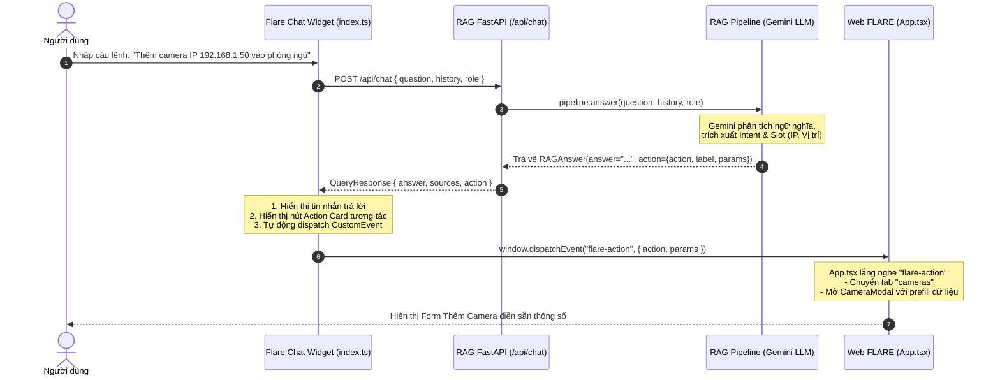

# Kiến trúc Trợ lý Tương tác Giao diện (Actionable AI Co-pilot Architecture)
**Dự án:** LOCAL-RAG & FLARE Web Integration  
**Cập nhật ngày:** 22/11/2026  
**Tác giả:** Đội ngũ phát triển FLARE AI  

---

## 1. Giới thiệu tổng quan

Trước đây, hệ thống **Flare AI (LOCAL-RAG)** hoạt động theo mô hình hỏi đáp truyền thống (Information Retrieval): người dùng hỏi về kiến thức PCCC hoặc hướng dẫn sử dụng hệ thống, và chatbot chỉ trích xuất tài liệu để trả về văn bản tĩnh.

Với kiến trúc mới **Actionable AI Co-pilot**, chatbot không chỉ trả lời câu hỏi mà còn **trực tiếp điều khiển và tương tác với giao diện Web FLARE** trong thời gian thực. Ví dụ:
- Người dùng nói: *"Thêm camera IP 192.168.1.50 vào phòng ngủ"*  
  👉 Chatbot vừa trả lời hướng dẫn, vừa **tự động chuyển sang tab Camera giám sát, mở modal Thêm Camera và điền sẵn IP `http://192.168.1.50:8080/video`, Tên `Camera Phòng ngủ`, Vị trí `Phòng ngủ`**.
- Người dùng nói: *"Bật webcam trực tiếp"*  
  👉 Chatbot tự động chuyển tab sang `Webcam trực tiếp` và kích hoạt luồng camera laptop.
- Người dùng nói: *"Xem lịch sử sự kiện"*  
  👉 Chatbot chuyển ngay sang tab `Sự kiện cảnh báo`.

---

## 2. Sơ đồ Luồng Hoạt động (End-to-End Event Flow)



---

## 3. Các thành phần đã thay đổi trong `LOCAL-RAG`

### 3.1. Chỉ dẫn Hệ thống (`src/rag/prompts.py`)
Bổ sung nguyên tắc thứ 6 vào System Prompt cho mọi vai trò có quyền thao tác:
- Hướng dẫn Gemini nhận diện ý định điều khiển giao diện của người dùng.
- Khi phát hiện ý định, Gemini gắn thêm khối mã đặc thù:
  ````markdown
  ```flare-action
  {
    "action": "ACTION_TYPE",
    "label": "Nhãn nút bấm hiển thị",
    "params": { ... }
  }
  ```
  ````
- Chi phí token cực thấp (chỉ ~15 - 30 tokens ở phần output, không tốn thêm chi phí embeddings hay retriever).

### 3.2. Bộ điều phối RAG (`src/rag/pipeline.py`)
- Định nghĩa lại dataclass `RAGAnswer`:
  ```python
  @dataclass
  class RAGAnswer:
      answer: str
      sources: list[SearchResult]
      action: dict | None = None
  ```
- Dùng Regex `r"```flare-action\s*(\{.*?\})\s*```"` để bóc tách khối action ra khỏi nội dung câu trả lời.
- Chuẩn hóa văn bản `clean_answer` để người dùng không nhìn thấy khối mã thô, giữ trải nghiệm trò chuyện tự nhiên nhất.

### 3.3. API Schemas & Routes (`src/api/schemas.py`, `src/api/routes.py`)
- Bổ sung schema `ActionPayload`:
  ```python
  class ActionPayload(BaseModel):
      action: str
      label: str = ""
      params: dict = Field(default_factory=dict)
  ```
- Bổ sung trường `action: ActionPayload | None = None` vào `QueryResponse`.
- Endpoint `POST /api/chat` trả về đầy đủ metadata hành động cho client.

### 3.4. Widget Trò chuyện (`widget/src/`)
1. **`types.ts`**:
   - Định nghĩa interface `FlareAction` và cập nhật `QueryResponse`.
2. **`styles.ts`**:
   - Bổ sung CSS cho `.flare-action-card`, `.flare-action-badge`, và `.flare-action-btn`.
   - Nút bấm có hiệu ứng gradient cam-đỏ đặc trưng của FLARE, icon SVG tia sét `⚡` và trạng thái đã kích hoạt (xanh lá `is-executed`).
3. **`index.ts`**:
   - **Cơ chế Dual-Engine Fallback**: Nếu vì bất kỳ lý do gì mô hình LLM không sinh action block (ví dụ câu hỏi ngắn hoặc độ trễ mạng), hàm `detectClientAction(question)` phía client sẽ tự động nhận diện regex intent để đảm bảo **100% không bao giờ bỏ sót lệnh của người dùng**.
   - **`dispatchWebAction(action)`**: Bắn sự kiện `window.dispatchEvent(new CustomEvent("flare-action", { detail: action, bubbles: true, composed: true }))`.
   - **`appendAssistantMessage`**: Render thẻ hành động (Action Card) nằm ngay trong bong bóng chat. Người dùng vừa được tự động thực thi, vừa có thể click lại nút bất cứ lúc nào nếu lỡ tay đóng form.

---

## 4. Danh mục Action hỗ trợ chi tiết

| Action Code | Ý nghĩa | Tham số (`params`) | Ví dụ câu lệnh người dùng |
| :--- | :--- | :--- | :--- |
| `NAVIGATE` | Chuyển sang màn hình/tab khác | `{"tab": "videos" \| "realtime" \| "cameras" \| "profile" \| "events" \| ...}` | *"chuyển sang tab camera"*, *"xem video tải lên"*, *"mở sự kiện cảnh báo"* |
| `ADD_CAMERA` | Mở modal Thêm camera & điền sẵn thông số | `{"stream_url": string, "name": string, "location": string}` | *"thêm camera IP 192.168.1.50 vào phòng ngủ"*, *"tạo camera mới với IP 192.168.1.100"* |
| `TOGGLE_WEBCAM` | Bật/tắt luồng phân tích webcam | `{"state": "start" \| "stop", "tab": "realtime"}` | *"bật webcam trực tiếp"*, *"mở cam laptop lên"*, *"tắt webcam"* |
| `CONNECT_ZALO` | Mở trang Hồ sơ để kết nối Zalo Bot | `{"tab": "profile"}` | *"kết nối bot zalo"*, *"hướng dẫn cài zalo nhận tin"*, *"cấu hình thông tin cá nhân"* |

---

## 5. Phía Web nhận diện & xử lý (`App.tsx`)

Trong dự án chính `Real_Time_Smoke_Fire_Detection_YOLO`:
1. `App` component đăng ký lắng nghe sự kiện:
   ```ts
   window.addEventListener("flare-action", (e: CustomEvent) => {
     const { action, params } = e.detail || {};
     // Điều phối setArea, __flarePendingCamera, __flareAutoStartWebcam
   });
   ```
2. `CamerasView` & `CameraModal`:
   - Tiếp nhận thông số `prefill` (`name`, `location`, `stream_url`) để tự động điền sẵn vào các ô input khi modal bật lên.
3. `RealtimeView`:
   - Tự động gọi `start()` khi nhận được tín hiệu `flare-webcam-toggle`.

---

## 6. Hướng dẫn Mở rộng (Add New Action)

Nếu sau này muốn bổ sung thêm hành động mới (ví dụ: `FILTER_EVENT_BY_DATE` hoặc `EXPORT_DATASET`):
1. **Bước 1**: Khai báo tên action và params mẫu vào `ACTION_INSTRUCTIONS` trong `src/rag/prompts.py`.
2. **Bước 2**: Bổ sung regex nhận diện nhanh trong `detectClientAction` tại `widget/src/index.ts`.
3. **Bước 3**: Chạy `npm run build` trong `widget/` và copy file `widget.js` mới sang frontend.
4. **Bước 4**: Thêm nhánh `case` xử lý tương ứng trong `useEffect` của `App.tsx`.

